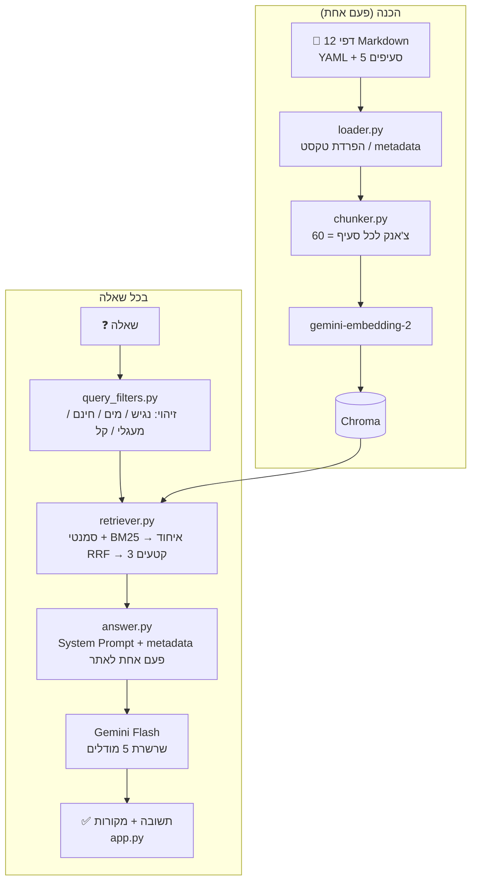

# 🧭 המדריך לגליל העליון: מערכת RAG

מערכת שאלות ותשובות על 12 אתרי טיול בגליל העליון. שואלים בשפה חופשית, והמערכת מאחזרת קטעים מהמאגר ועונה **רק** על בסיסם, עם הצגת המקורות.
**טכנולוגיות:** Python · LlamaIndex · Chroma · Google Gemini (חינמי) · Streamlit

## מה הוגש, לפי דרישות התרגיל

| דרישה | איפה |
|---|---|
| 1. נושא ואיסוף מידע | `data/`: 12 דפי אתרים |
| 2. טעינה וחלוקה למקטעים | `loader.py`, `chunker.py` |
| 3. Embeddings ו-Vector Store | `indexer.py` (Gemini + Chroma) |
| 4. Retrieval | `query_filters.py`, `retriever.py` |
| 5. יצירת תשובה | `answer.py` |
| 6. הצגת מקורות | `app.py` (Streamlit) |
| 7. בדיקות | `eval_retrieval.py`, ו-5 דוגמאות למטה |

## הרצה

```
py -m venv .venv
.venv\Scripts\activate
python -m pip install -r requirements.txt
```
יוצרים קובץ `.env` עם מפתח מ-Google AI Studio: `GOOGLE_API_KEY=...`, ואז:
```
streamlit run app.py
```
בהרצה הראשונה האינדקס נבנה אוטומטית ונשמר בתיקייה `storage`.

## ארכיטקטורה



## בחירות טכנולוגיות

| רכיב | בחירה | למה |
|---|---|---|
| נתונים | 12 דפים, YAML + 5 סעיפים קבועים | מבנה אחיד: שדות לסינון, טקסט לחיפוש |
| Chunking | צ'אנק לכל סעיף `##` | נמדד מול דף שלם: אותה פגיעה (9/9) בשאלות הבדיקה, ועלות משוערת קטנה **פי ~4** (כ-530 מול 2,040 טוקנים לשאלה) |
| Embeddings | `gemini-embedding-2` | חינמי, רב-לשוני (עברית) |
| Vector Store | Chroma (cosine) | ההמלצה בחוברת לפרויקט לימודי; נבנה מחדש אוטומטית רק כשהנתונים או קוד החלוקה משתנים |
| Retrieval | היברידי: סמנטי + BM25, `top_k=3` | BM25 תופס מילים נדירות שהחיפוש הסמנטי מפספס |
| Query rewriting | לא מומש; במקומו סינון metadata | אף כישלון בבדיקה לא נבע מניסוח שונה |
| LLM | שרשרת 5 מודלי Gemini Flash, מהחזק לחלש | מודלי Pro נבדקו וחסומים בתוכנית החינמית (429); בעומס עוברים למודל הבא |
| טוקנים | קריאת LLM אחת לשאלה, metadata פעם אחת לאתר, System Prompt קצר | חיסכון בלי לפגוע בדיוק |

## דוגמאות שאלות ותשובות

| # | שאלה | מה זה בודק | תשובה (מקוצרת) | מקורות |
|---|---|---|---|---|
| 1 | איפה אפשר לראות עגורים? | שאלה בסיסית | באגמון החולה ובשדות עמק החולה; בשקיעה מתכנסים ללינה באגמון | אגמון החולה: מה רואים, תיאור, טיפים |
| 2 | מסלול עם מים שמתאים לכיסא גלגלים | סינון metadata (♿ + 💧) | נחל שניר (מסלול קצר מונגש), נחל עיון (כ-400 מ' למפל התנור), שמורת החולה (שביל וגשר עץ) | נחל שניר, נחל עיון, שמורת החולה |
| 3 | איפה אפשר לעשות טיול גיפים? | מילה נדירה, בלי גרש (BM25) | בחלקו העליון של נחל דישון | נחל דישון: תיאור |
| 4 | מה ההבדל בין אגמון החולה לשמורת החולה? | השוואה | ניהול (קק"ל / רט"ג), אגם מלאכותי מול שריד ביצה, דמי כניסה ("לא אומת" באגמון), משך ביקור | אגמון החולה, שמורת החולה |
| 5 | מה שעות הפתיחה של תל דן? | **אין במאגר** | "אין לי מידע על כך במאגר." | אין (לא מוצגים מקורות) |

**בדיקת אחזור (`eval_retrieval.py`):** 19 שאלות, כולל 8 קשות ו-2 שאין להן תשובה. **פגיעה 17/17**: בכל שאלה שיש לה תשובה, לפחות אתר נכון אחד נשלף. בשאלות שיש להן כמה אתרים נכונים נשלפו בממוצע 70% מהם.

## בעיות שנתקלנו בהן ואיך שיפרנו

| בעיה | מה עשינו | תוצאה |
|---|---|---|
| **metadata כפול:** ה-metadata של אתר (111 טוקנים) היה גדול כמו סעיף (112), ונשלח עם כל סעיף | ניסינו דף שלם (נפסל במדידה: יקר כמעט פי 2). נשארנו עם סעיפים, ו-metadata נשלח **פעם אחת לכל אתר** | חיסכון משוער של כרבע מהטוקנים בהקשר (כ-850 במקום 1,113) |
| **מילה נדירה:** "טיול ג'יפים" לא מצא את נחל דישון | חיפוש היברידי עם BM25 מותאם לעברית; בהמשך גם התעלמות מגרשים ("גיפים" = "ג'יפים") | נמצא, ואף שאלה שעברה קודם לא נשברה |
| **מידע רק ב-metadata:** "בלי לשלם" נכשל | חילוץ תנאים בעזרת LLM נכשל במכסה (429 ב-8 מתוך 19 שאלות), ולכן הוחלף **בזיהוי מילות מפתח** | אפס טוקנים; השאלה עוברת, והסינון הופעל רק בשאלות הנכונות |
| **"אין תשובה" לא מזוהה בציון:** שאלה בלי תשובה קיבלה ציון גבוה משאלה עם תשובה | System Prompt: "ענה רק מהמקורות, אחרת: אין לי מידע"; מוצגים רק מקורות שהתשובה מזכירה | בבדיקות המערכת לא המציאה תשובה, ובתשובת "אין מידע" לא מוצגים מקורות |
| **נתונים לא מתאימים לסינון:** "כן (שבילים סלולים)" בשדה אחד | פיצול לערך (כן / לא / חלקית / לא אומת) ולשדה `_note` | סינון מדויק, וההסבר נשמר לתשובה |
| **עומס במודלים (503/429):** האפליקציה נתקעה או קרסה | שרשרת 5 מודלים עם הגבלת זמן, בלי בדיקה מראש בהפעלה | בעומס עוברים למודל זמין; אם אין, מוצגת הודעה ידידותית |

פירוט מלא של 15 בעיות, עם מספרים, ב-[`NOTES.md`](NOTES.md).

## בונוסים

- **השוואת 2 אסטרטגיות Chunking:** סעיף מול דף, בטוקנים ובאיכות אחזור.
- **Metadata Filtering:** נגישות, מים, מסלול מעגלי, מחיר, קושי.
- **הערכה במדדים:** Recall@k וכיסוי על 19 שאלות.

## מגבלות ידועות

- **אין זיכרון שיחה:** כל שאלה נענית בנפרד, לפי דרישות התרגיל. שאלת המשך ("איפה זה?") דורשת ניסוח מחדש בעזרת LLM, ולא מומשה בגלל מכסת התוכנית החינמית.
- **סינון לפי מילות מפתח:** ניסוח שלא ברשימה לא יפעיל סינון.
- **מקורות מסוננים לפי אתר, לא לפי סעיף.**
